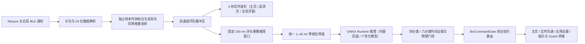

# BCI Agent（`bci-agent` / BCI 扫描输入法）

面向耳电（Ear-EEG）脑机接口的 Android 康复交互与娱乐客户端（应用包名：`com.example.input_ds`，安装显示名称：`BCI扫描输入法`）。项目基于 Jetpack Compose 构建，面向横屏康复平板（`arm64-v8a`），将双耳 BLE 脑电采集、实时波形监测、ONNX 端侧异步推理、T9 拼音扫描输入、多源上下文预测、扫描速度校准、个性化云端采集与训练，以及原生/Godot/WebView 娱乐与影音模块整合在同一应用中。

当前应用以独立 `Activity` 运行，尚未声明 Android 系统级 `InputMethodService`，因此它是一套完整的康复交互与扫描输入客户端，而非可在其他 App 中直接呼出的系统键盘。

仓库地址：[Ruizhi-Owl/bci-agent](https://github.com/Ruizhi-Owl/bci-agent)（基于 [WoodenCatter/special_input_method](https://github.com/WoodenCatter/special_input_method) 演进）。

## 核心特性

- **四入口主页架构**：主页提供“应用设置”“实时沟通”“娱乐”“设备与模型”四个模块，并实时展示 `Naoyun Pods BLE` 设备连接状态、左右耳电量与佩戴状态及双通道波形。前三个模块支持光标自动轮转，“设备与模型”保留为照护者触控入口。
- **T9 扫描沟通与多源预测**：左侧 5 块（`ABC`、`DEF`、`GHI`、`JKL`、`完成`）、右侧 5 块（`MNO`、`PQRS`、`TUV`、`WXYZ`、`删除`），支持拼音组合、汉字候选、常用语、开场句与下一词续写；候选由本地语言模型与用户词典优先给出，再异步融合 Rime（OpenCC 简繁转换）与可选远程 LLM 结果。
- **分级应用设置与扫描速度校准**：“应用设置”区分为病人可扫描项（音量、屏幕亮度、悬浮球显示/隐藏、扫描速度校准、返回主页）与医护人员触控项（手动启用/停用真实耳机控制）；“扫描速度校准”支持模拟与真实耳机双模式独立练习与速度推荐（`1100–3000 ms`）。
- **多形态娱乐与影音模块**：
  - **原生 Compose 游戏**：四分类/六分类异步迷宫、向上贪吃蛇。
  - **Godot 嵌入游戏**：内嵌 Godot 4.7.1 运行时（`WizardGameActivity` + `wizard_game.pck`）的魔法师游戏。
  - **WebView 离线棋牌**：中国象棋、斗地主、打麻将，均内置 AI 与独立扫描交互层。
  - **影音娱乐**：基于 Media3 ExoPlayer 的本地音乐播放器（含 10 首内置曲目及本地导入、歌词/封面/歌单/播放状态持久化），以及基于央视官方网页入口的电视播放（`CCTV-1`～`CCTV-17`）。
- **无耳机测试与全局信号浮窗**：全局绿色“模拟”悬浮球（`FloatingControlBall`）可随时模拟左看、右看、咬牙，并与真实耳机共用统一路由；连接耳机后，除主页与速度校准页外均会显示可拖拽的实时双通道 EEG 悬浮窗（`FloatingEegSignalWindow`，含 Godot 游戏界面）。
- **双耳 BLE 同步采集与端侧推理**：支持 `Naoyun Pods BLE` 500 Hz 双通道采集、独立仿射时钟拟合与共同 2 ms 网格重采样、静默断流检测与分级恢复、统一 `1–45 Hz` 零相位带通滤波、ONNX Runtime 四分类/六分类异步事件检测与运行日志记录。
- **个性化闭环训练与数据恢复**：支持本地多用户、`client_profile_id` / `profile_id` 幂等同步、5 秒双耳原子分块流式上传（SHA-256 校验与 WorkManager 断点续传）、服务端异步训练、ONNX 自动校验启用及卸载重装后的数据与模型恢复。

## 系统链路



## 应用模块与页面层级

```text
主页 (HomeScreen)
├─ 应用设置 (AppSettingsScreen)：音量、亮度、模拟悬浮球开关、扫描速度校准、医护耳机控制开关
├─ 实时沟通 (MainScreen)：T9 字母块、拼音组合、汉字候选、预测词、常用语、校准速度入口
├─ 娱乐 (EntertainmentScreen)
│  ├─ 迷宫游戏 (MazeScreen)
│  ├─ 向上贪吃蛇 (SnakeClimbScreen)
│  ├─ 魔法师游戏 (WizardGameActivity / Godot 4.7.1)
│  ├─ 中国象棋 (ChineseChessScreen / WebView)
│  ├─ 斗地主 (DoudizhuScreen / WebView)
│  ├─ 打麻将 (MahjongScreen / WebView)
│  ├─ 看电视 (TvScreen / WebView)
│  └─ 音乐 (MusicScreen / Media3)
└─ 设备与模型 (CollectionScreen)：扫描设置、服务器绑定、本地用户、采集模型与参数、采集与训练记录
   └─ 设备流程 (DeviceFlow)：BLE 扫描 (BleScanScreen) / 信号监测 (SignalMonitorScreen) / 连续采集
```

| 模块 | 实现技术 | 控制与交互特点 |
|---|---|---|
| 主页 | Jetpack Compose | 自动轮转（仅前 3 个患者入口参与扫描）；展示设备连接、电量、佩戴状态与 5 秒双耳波形 |
| 应用设置 | Jetpack Compose | 左侧患者扫描操作（音量/亮度/悬浮球/速度校准/返回）；右侧医护触控开关控制真实耳机使能 |
| 实时沟通 | Compose + Rime JNI + LLM | T9 10 块扫描输入；本地/Rime/远程预测稳定合并；“完成”仅归档本轮输入并清空，不发送外部消息 |
| 扫描速度校准 | Compose + 状态机 | 12 次目标选择（3 组 × 4 目标），独立区分 `SIMULATION` 与 `HEADSET` 模式 |
| 迷宫游戏 | Jetpack Compose | 四分类移动；六分类额外支持“左右 / 右左”清除两类障碍，提供扫描式退出与结束选择 |
| 向上贪吃蛇 | Jetpack Compose | 定时自动前进，左看/右看转向，咬牙向上或在已向上时呼出退出确认 |
| 魔法师游戏 | Godot 4.7.1 (`WizardGameActivity`) | 独立横屏 `GodotActivity`，通过 `InputDsGameBridgePlugin` 接收前台指令并叠加双通道波形与悬浮球 |
| 中国象棋 / 斗地主 / 打麻将 | WebView (HTML/JS) + Bus | 内置离线 AI 与音效；通过 `ChineseChessInputBus` / `DoudizhuInputBus` / `MahjongInputBus` 统一接入扫描与确认 |
| 看电视 | WebView (`CctvOfficialPlayer`) | 内置 13 个央视官方直播网页入口（`CCTV-1`～`CCTV-17`），支持换台与操作弹层扫描；不可播频道给出提示 |
| 音乐 | Media3 ExoPlayer | 内置 10 首曲目并支持本地导入、封面/歌词解析、歌单、播放模式、音量、删除与断点进度保存 |
| 设备与模型 | Compose + WorkManager | 触控管理页，不参与自动扫描；负责服务器绑定、用户管理、连续 NPZ 采集与训练任务监控 |

## 输入交互规范

全局页面层级、指令所有权、返回优先级与确认规则见 [全局操作规范](docs/INTERACTION_SPEC.md)，验证状态见 [操作规范验证记录](docs/INTERACTION_VALIDATION.md)。核心约定包括：

- **普通扫描菜单**：左看/右看仅改变扫描方向（不立即跳项），咬牙执行高亮项；覆盖应用设置、棋牌菜单、音乐分层菜单、电视操作弹层等。
- **确认窗口与结局二选一**：取消在左、确定在右，默认高亮取消；左右看明确选择取消或确定，等待不会自动切换决定；咬牙执行当前选择。
- **指令所有权与安全门控**：`BciCommandGate` 与 `InputContextBoundary` 确保同一时刻只有当前前台页面或最上层弹层接收动作；页面切换、弹窗切换或退回后台会立即作废未投递窗口。真实耳机控制默认关闭，需在连接稳定后于“应用设置”右侧手动启用。
- **全局扫描周期**：默认 `1500 ms`，可在 `1100～3000 ms` 区间调整并持久化到本机；该参数仅控制界面高亮停留时间，不影响异步 EEG 推理的窗口长度或 `100 ms` 步长。

### 实时沟通输入阶段

| 阶段 | 左看 | 右看 | 咬牙 |
|---|---|---|---|
| 一级块扫描 | 切到左侧，或选择左侧高亮块（含“完成”） | 切到右侧，或选择右侧高亮块（含“删除”） | 有拼音输入时进入拼音组合；否则进入常用语选择 |
| 拼音组合 | 高亮方向改为向左 | 高亮方向改为向右 | 确认当前拼音并进入候选字 |
| 候选字 | 高亮方向改为向左 | 高亮方向改为向右 | 确认当前汉字并触发下词预测 |
| 预测词 / 开场句 | 高亮方向改为向左 | 高亮方向改为向右 | 确认当前候选词/句 |

选定汉字后，界面先展示用户历史与本地语言模型候选，再并行追加 Rime（OpenCC 简繁转换）与经过身份认证的远程上下文候选；首句输入支持按 T9 块序列查询本地开场句索引并由远程服务补充。候选采用稳定追加与去重，扫描开始后已有项不会因慢响应重排。未配置服务器凭据、超时或网络失败时自动回退本地结果。Debug 构建会在 `InputMethodViewModel` 中生成短暂的 `PredictionDebugInfo` 状态（对应 `PredictionDebugOverlay.kt` 诊断组件，当前默认未挂载至实时沟通界面）。

## 扫描速度校准

入口位于“应用设置 → 扫描速度校准”或“实时沟通 → 校准速度”，与 EEG 模型校准相互独立：

- 共 12 次目标选择（3 组 × 4 个固定顺序目标：`喝水 / 吃饭 / 休息 / 帮助`），第一组使用当前扫描速度。
- 目标高亮时咬牙确认（模拟模式亦可点击界面按钮或使用悬浮球）；左看可暂停，暂停菜单支持扫描恢复或放弃。
- 仅在耳机已连接且“应用设置”中已启用耳机控制时开放耳机模式练习；两种输入模式严格隔离，模拟信号不会替代耳机作答。
- 每组结束后，若 4 题均在第一轮选对，则下一组步长减少 `200 ms`，否则增加 `300 ms`，始终限制在 `1100～3000 ms`。题目进行中不改变速度。
- 两轮（8 步）内未确认计为未完成；切到后台、UI 阻塞或耳机断流自动暂停，恢复时重做未完成题，不计作选错。
- 至少有一组正确 ≥ 3 次时才提供推荐（按正确率优先，其次整组平均耗时，最后较高步长）；只有用户主动选择“使用推荐速度”才会保存并覆盖全局扫描速度。
- 练习摘要以原子 JSON 写入应用私有目录 `files/scan_calibration/`，仅记录输入模式、逐题目标与选择、耗时、步长与接受状态，不含原始 EEG 或沟通文本，不主动上传。

详细验收流程见 [扫描速度校准验收](docs/SCAN_CALIBRATION.md)。

## BCI 设备、采集与数据流

当前 BLE 协议针对设备名匹配 `Naoyun Pods BLE`（BLE-096E）的双耳设备：

- **采样参数**：`500 Hz`、双通道（左耳 / 右耳）、每耳每包 `50` 个采样点（约 `10 包/秒/耳`）、24 位原始值转物理量（`µV`）、无符号 8 位循环包计数。
- **双耳同步与重采样**：`EegStereoPacketAligner` 分别为左右耳维护原始样本索引和最近 10 秒包尾单调时钟锚点，实时拟合两套独立仿射时钟以跟踪晶振漂移。绘图、推理与采集取窗时动态截取双耳共同覆盖区间并线性重采样至统一 `2 ms` 网格；任一耳检测到丢包或乱序会清空插值历史并递增 `synchronizedDataEpoch`，采集时仅废弃并重采受影响的当前 Trial。
- **流活性监测与恢复**：`BleStreamLiveness` 每 `250 ms` 检查双耳与共同进度新鲜度：超过 `1 s` 标记延迟，超过 `1.5 s` 判定断流。若两耳底层包仍到达，仅本地重置对齐状态；若某侧停止到达，先重发 `OPEN_DATA`，`3 s` 后仍未恢复则重连 GATT。单轮最多尝试 `3` 次，采集中则每隔至少 `5 s` 持续尝试恢复。
- **实时波形**：波形组件以 `50 ms` 周期重建最近 5 秒双耳共同窗口，执行 `1–45 Hz` 滤波后按 `-200～200 µV` 固定量程绘制。
- **权限要求**：Android 12+ 需要 `BLUETOOTH_SCAN` 与 `BLUETOOTH_CONNECT`；Android 11 及以下需要旧蓝牙权限与 `ACCESS_FINE_LOCATION`（部分系统需开启位置服务）。

## 预处理与实时推理

### 统一预处理

实时波形绘制、ONNX 端侧推理、采集上传 metadata 与模型下载校验统一采用 **`1–45 Hz` 二阶 Butterworth 零相位带通滤波（`filtfilt`）**。切换训练算法（如 `wheelchair-eegnet`、`csanet`）不改变预处理契约；历史 Session 中的旧预处理标识在读取时统一迁移至当前契约。

### 异步控制策略

`BciController` 运行在独立单线程推理调度器（`bci-inference`）上，按固定 `100 ms` 步长（500 Hz 下 `50` 点）截取定长窗口（积压超过 5 个步长时跳过旧窗并重置时序证据）。

- **时间证据累积（`TemporalEvidenceAccumulator`）**：保存最近 `5` 个单窗投票；当某个非 Rest 类别获得至少 `3` 票且这些支持窗的平均置信度 ≥ `0.85` 时形成动作候选。
- **物理门控与防连发**：四分类差分活动量与六分类动作活动量/组合跨度在候选形成后校验最近 5 窗中至少 `2` 窗存在对应物理活动证据（不修改模型输出的左右语义）。命令发出后进入锁定状态，需连续 `3` 个置信度 ≥ `0.85` 的 `Rest` 单窗才重新解锁。
- **诊断日志**：每次异步控制运行在内部存储 `files/bci_async_runs/` 下生成 `run.json`、`windows.jsonl`、`events.jsonl`，触发动作的事件同时保存原始双通道 `.npy` 窗口。

### 类别顺序与 ONNX 约束

- **四分类（`four_class`）**：`0 = rest（静息）`、`1 = jaw（咬牙）`、`2 = look_left（左看）`、`3 = look_right（右看）`
- **六分类（`six_action` / `six_class`）**：`0 = rest（静息）`、`1 = look_left（左看）`、`2 = look_right（右看）`、`3 = jaw（咬牙）`、`4 = look_left_right（左右）`、`5 = look_right_left（右左）`
- **输入形状**：兼容 `(1, 2, N)` 与 `(1, 1, 2, N)`；输出须为单窗口 `float32` logits 或 probabilities。
- **模型回退与校验**：优先加载当前活动用户的个性化 ONNX（同时校对匹配的 `async_calibration.json`）；无可用个性化模型时，依次回退至内部存储或 `assets/model.onnx` / `assets/csanet_model.onnx`。

## 个性化采集、上传与训练

- **账号绑定与多用户隔离**：设备绑定一组服务器账号（默认服务地址 `https://smu-brain.online`，定义于 `BrainApiClient.BASE_URL`），API Key 经 Android Keystore AES-GCM 加密保存；本地可创建多个用户，各自持有永久 `client_profile_id` 并在联网后幂等映射至服务端 `profile_id`。
- **重装恢复与旧契约迁移**：在新设备或重装后绑定同一服务器账号，会自动拉取云端 profile、已上传数据集、训练记录及可用 ONNX 并启用验证准确率最高者；若旧模型不符合当前 `1–45 Hz` 契约，客户端会自动下载原始 NPZ 并以新契约上传重训。
- **连续 Trial 采集范式**：采集轮次 `4～100`、动作时长 `0.8～5.0 s`、训练轮次 `1～50`（默认 `50`）。开采前须双耳连续两个 1 秒检测窗采样率均在 `450～550 Hz`。每个 Trial 按 `随机前静息 → 提示音 (Ignore) → 动作 → 随机后静息` 完整采集，需落在同一 `synchronizedDataEpoch` 内，丢包或重连仅重采当前 Trial。
- **流式分块上传与后台训练**：采集结果保存为连续双通道 `continuous.npz`（`left.npy` / `right.npy`），采集期间每 `5 s` 封装一次双耳原子分块（含 SHA-256）并发往服务端，采集完成后提交 Trial/Ignore 标注并创建训练任务，由 `PersonalizationSyncWorker`（WorkManager）自动轮询、下载、校验并切换最佳模型。详细接口协议见 [服务端流式上传指南](docs/SERVER_STREAMING_UPLOAD_GUIDE.md)。

## 快速开始

### 环境要求

- **JDK 21**（与 `gradle/gradle-daemon-jvm.properties` 中 `toolchainVersion=21` 一致）。
- **Android SDK**：`compileSdk = 36`（minor 1）、`targetSdk = 36`、`minSdk = 24`（Android 7.0+）。
- **目标架构**：`arm64-v8a`（见 `app/build.gradle.kts` `abiFilters`，适配康复平板及内置 Godot / Rime 原生库）。
- **可选硬件与服务**：`Naoyun Pods BLE` 双耳脑电设备、可访问的个性化训练后端账号。

### 构建与安装

macOS / Linux：

```bash
./gradlew :app:assembleDebug
```

Windows（PowerShell）：

```powershell
.\gradlew.bat :app:assembleDebug
```

生成的 Debug APK 位于 `app/build/outputs/apk/debug/app-debug.apk`，可通过 ADB 安装：

```bash
adb install -r app/build/outputs/apk/debug/app-debug.apk
```

也可直接在 Android Studio 中打开仓库根目录并运行 `app` 配置。

## 项目结构

```text
.
├── app/src/main/
│   ├── AndroidManifest.xml
│   ├── assets/
│   │   ├── model.onnx            内置四分类回退模型
│   │   ├── wizard_game.pck       Godot 魔法师游戏资源包
│   │   ├── chinese_chess/        中国象棋 WebView 资源与 AI
│   │   ├── doudizhu/             斗地主 WebView 资源、AI 与语音包
│   │   ├── mahjong/              麻将 WebView 资源、牌面 SVG 与语音包
│   │   ├── pinyin_map.txt        拼音与汉字映射
│   │   ├── bigrams.txt           二元语言模型
│   │   ├── trigrams.txt          三元语言模型
│   │   └── rime_prediction/      Rime 预测词库与 OpenCC 配置
│   ├── jniLibs/                  librime_jni.so 原生库
│   ├── res/raw/                  10 首内置音乐 MP3 资源
│   └── java/
│       ├── com/example/input_ds/
│       │   ├── MainActivity.kt   主应用宿主、页面路由与信号分发
│       │   ├── bci/              BLE 协议、双耳时钟对齐、滤波、ONNX 推理与异步控制
│       │   ├── calibration/      扫描速度校准策略与 ViewModel
│       │   ├── chess/            中国象棋控制总线
│       │   ├── data/             T9 映射、拼音字典、N-gram 与用户词典
│       │   ├── doudizhu/         斗地主控制总线
│       │   ├── engine/           拼音恢复、本地/Rime/远程 LLM 预测与稳定合并
│       │   ├── game/             迷宫与向上贪吃蛇规则引擎
│       │   ├── mahjong/          麻将控制总线
│       │   ├── media/            早期 Media3/CCTV 解析工具（兼容保留）
│       │   ├── model/            页面导航、输入状态、交互规则与扫描设置
│       │   ├── music/            本地音乐库、Media3 播放控制与持久化
│       │   ├── personalization/  多用户、连续 NPZ 采集、流式上传与模型管理
│       │   ├── rime/             Rime 预测数据部署
│       │   ├── settings/         应用设置输入总线
│       │   ├── tv/               电视输入总线
│       │   ├── ui/               Compose 页面（主页/设置/校准/沟通/娱乐/游戏/音乐/电视/监测/采集）
│       │   ├── viewmodel/        扫描输入状态机（InputMethodViewModel）
│       │   └── wizard/           Godot 魔法师宿主 Activity 与插件桥接
│       └── com/osfans/trime/     Rime JNI 绑定接口
├── app/src/test/
│   ├── java/com/example/input_ds/ JVM 单元测试
│   └── js/                       WebView 棋牌交互契约与麻将引擎测试
├── docs/                         交互规范、验证记录、校准验收与流式上传文档
├── LICENSES/                     第三方开源许可证文本
├── THIRD_PARTY_NOTICES.md        第三方组件声明
├── export_onnx.py                PC 端 CSANet → ONNX 导出辅助脚本
├── PRD-v2.md                     T9 扫描输入法工作流程设计文档
└── 流程.md                       T9 输入与拼音恢复示例推演
```

应用私有存储关键目录（不随 Android Auto Backup 同步，以保护耳电数据与 API Key 隐私）：

- `files/personalization/`：本地用户、采集 Session 记录、`models/profiles/{profile_id}/` 隔离模型及校验文件。
- `files/scan_calibration/`：扫描速度校准练习 JSON 摘要。
- `files/bci_async_runs/`：异步控制窗口概率、事件日志与触发动作的 `.npy` 原始窗口。

## 测试与调试

### 自动化测试与静态检查

```bash
# Android JVM 单元测试与静态 Lint 检查
./gradlew :app:testDebugUnitTest :app:lintDebug

# WebView 棋牌交互契约与引擎 Node.js 测试
node app/src/test/js/interaction_contract_test.mjs
node app/src/test/js/chess_interaction_test.mjs
node app/src/test/js/mahjong_engine_test.js
```

JVM 单元测试覆盖：BLE 分包与解析、双耳共同网格重采样与丢包重置、`BleStreamLiveness`、`1–45 Hz` 预处理链、`BciCommandGate`、四/六分类异步检测与 `TemporalEvidenceAccumulator`、迷宫与贪吃蛇规则、`InteractionRules` 与页面导航/分页、`ScanCalibration` 策略、Rime/本地/远程预测文本校验与稳定合并、NPZ 打包、流式分块编码、共享 Token 缓存及服务器历史恢复逻辑。

### 常用 Logcat 标签

| 标签 | 内容 |
|---|---|
| `NaoyunBLE` | 设备扫描、GATT 连接、通知初始化、时钟重采样与对齐状态 |
| `BciController` | 连续重叠窗口调度、数据不足、命令执行与门控失效日志 |
| `ModelInference` | ONNX 路径、输入 shape、四/六分类输出语义、置信度与异常 |

```bash
adb logcat -s NaoyunBLE:D BciController:D ModelInference:D
```

## 当前限制

- 非系统级 Android IME，沟通输出保留在应用界面内。
- 电视功能依赖网络与央视官方网页，部分频道可能因版权、地区或上游页面策略暂不可播；本地音乐播放不依赖网络。
- BLE UUID、数据包格式（500 Hz、50 点/包）针对 `Naoyun Pods BLE` 实现。
- 构建配置限定 `arm64-v8a` ABI；Release 签名流程及远程服务器地址切换界面尚未配置（`BASE_URL` 当前为编译期常量）。
- `files/bci_async_runs/` 日志暂无应用内回看 UI；`PredictionDebugOverlay` 诊断浮层尚未挂载到实时沟通界面。

## 第三方组件与许可

项目使用了 AndroidX、Jetpack Compose、ONNX Runtime、Media3、OkHttp、Godot 4.7.1 以及 Rime/Trime/OpenCC 等开源组件，离线棋牌模块亦基于开源项目改造。完整归属与许可条款见 [THIRD_PARTY_NOTICES.md](THIRD_PARTY_NOTICES.md) 和 [LICENSES](LICENSES/)。
